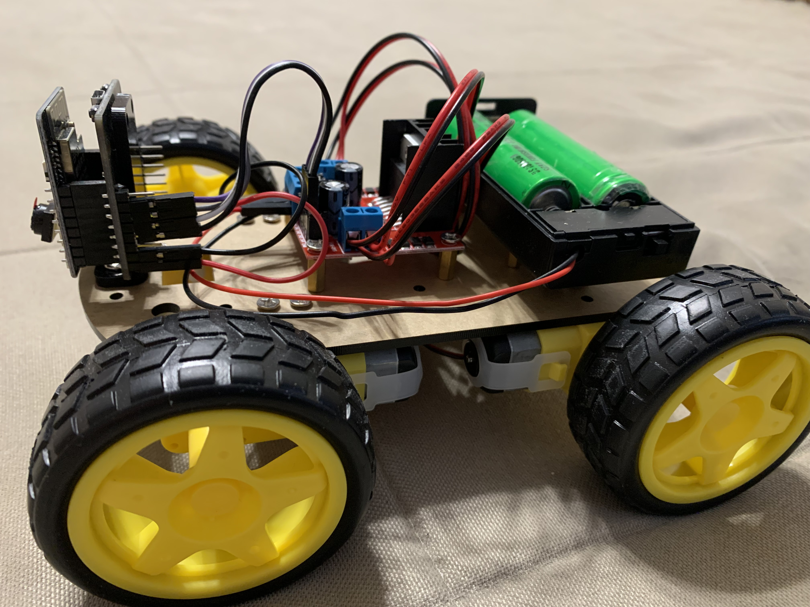
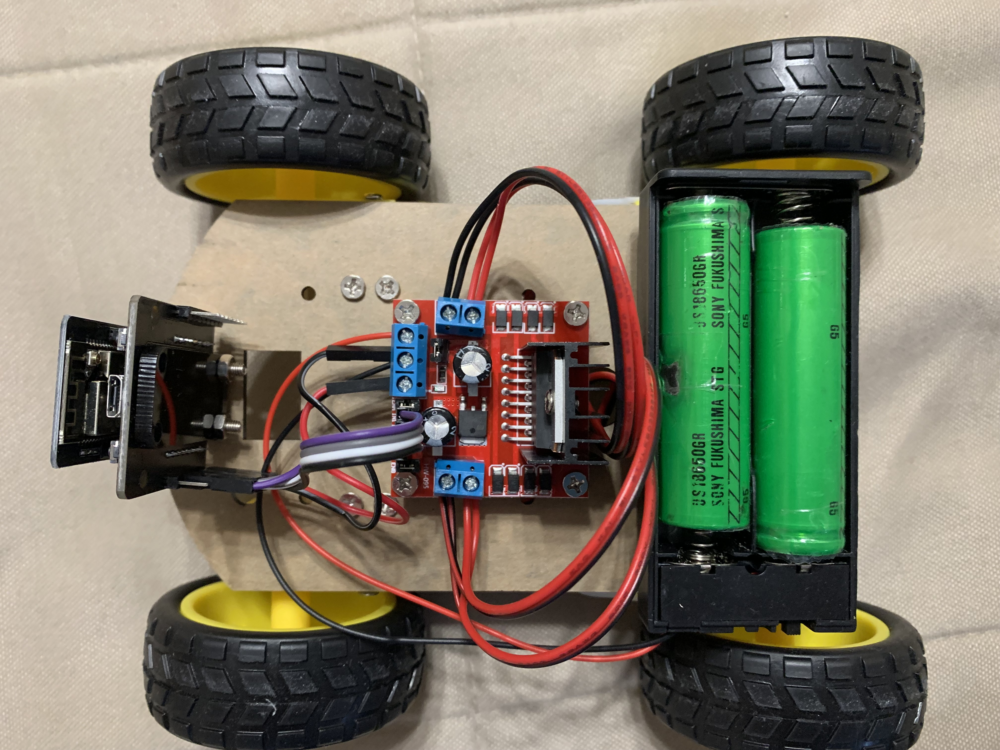
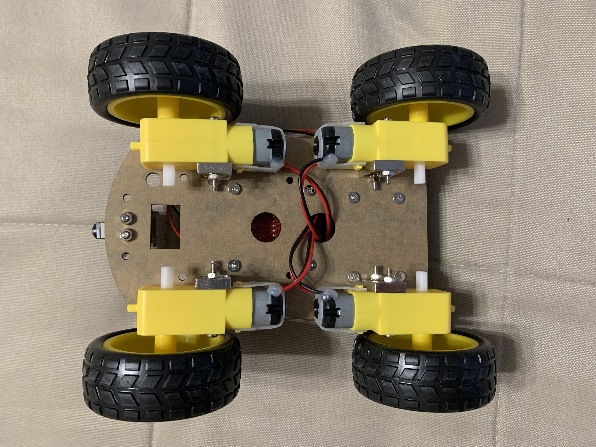
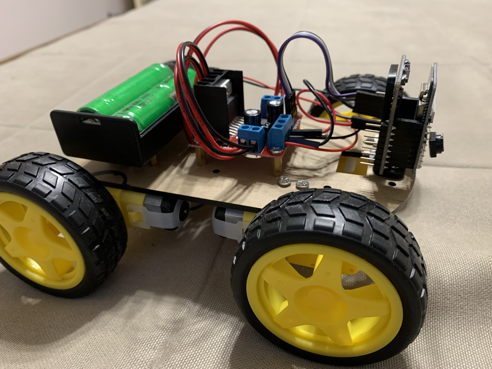

# ESP32-CAM 4WD Smart Robot Car

A four-wheel-drive robot car based on the Keyestudio KS5024 kit. It uses an ESP32-CAM to stream live camera images and provide browser-based control over Wi-Fi, including movement, speed adjustment, and the onboard light.

The robot was assembled following the [official Keyestudio instructions](https://docs.keyestudio.com/projects/KS5024/en/latest/docs/4WD%20Camera%20Robot%20Car.html#).

## Board and port

- **Board:** AI Thinker ESP32-CAM
- **macOS serial port:** `/dev/cu.wchusbserial120`

## Differences from the documented kit

- The kit did not include an external antenna, so the assembled robot has no external antenna installed.
- The supplied motor controller differs from the one shown in the instructions and has a different connection layout.
